<div align="center">


# Nerve

**The cockpit OpenClaw deserves.**

*OpenClaw is powerful. Nerve is the interface that makes people say "oh, now I get it."*

[](https://github.com/daggerhashimoto/openclaw-nerve)
[](LICENSE)
[](https://discord.gg/Sh9ZGtctva)

[Website](https://nerve.zone) · [Docs](docs/README.md) · [Discord](https://discord.gg/Sh9ZGtctva) · [Changelog](CHANGELOG.md)

</div>

```bash
curl -fsSL https://raw.githubusercontent.com/daggerhashimoto/openclaw-nerve/master/install.sh | bash
```
> *Run the installer, live in 60 seconds*

<div align="center">

<!-- demo-video:start -->
https://github.com/user-attachments/assets/e5cd9150-4f3f-4050-a63c-190e6947e3a2
<!-- demo-video:end -->

<table>
<tr>
<td align="center">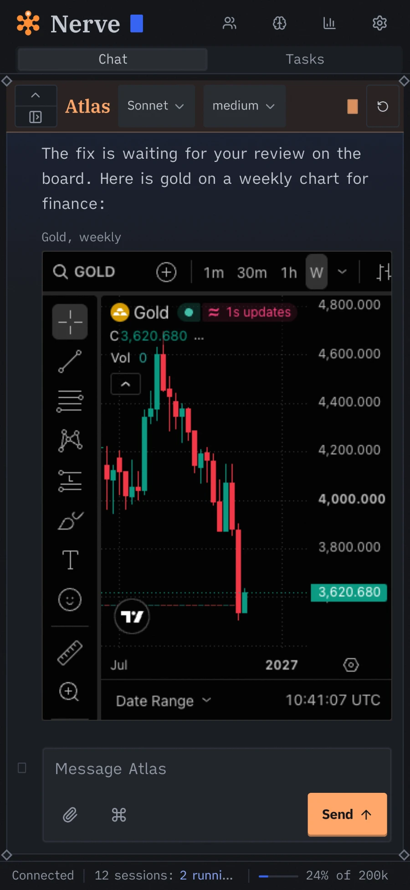</td>
<td align="center">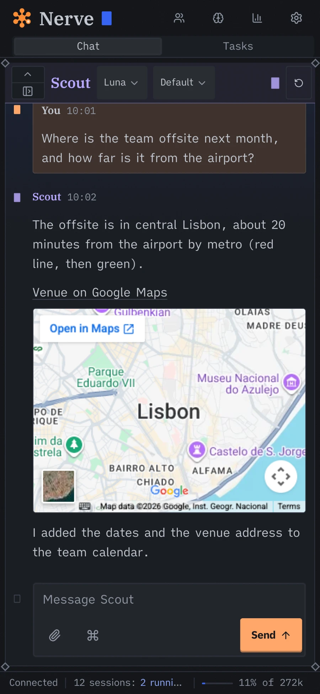</td>
<td align="center">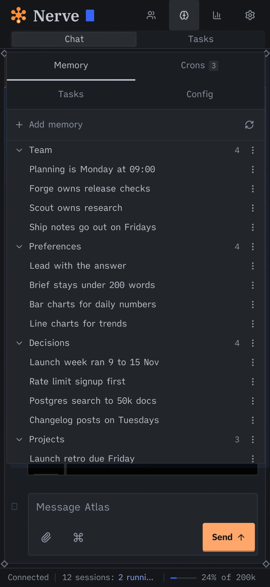</td>
<td align="center">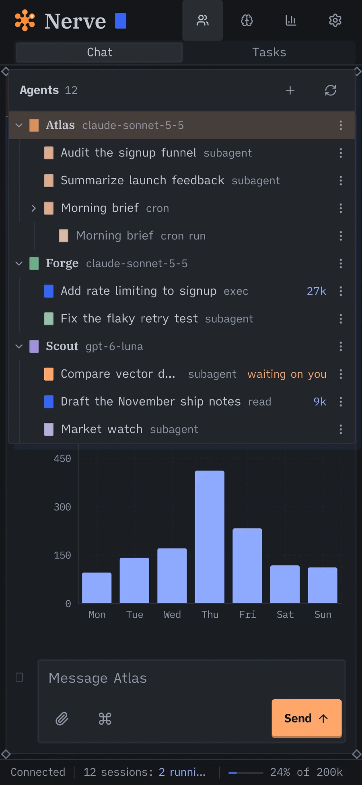</td>
</tr>
</table>

</div>

## Why Nerve exists

Chat is great for talking to agents.
It is not enough for operating them.

The moment you care about visibility, control and coordination over your agents, the thread gets too small. You want the workspace, sessions, taskboard, editor, usage, and agent context in one place.

*Nerve is that place.*

## Why it feels different

### Fleet control, not just chat
Run multiple agents from one place. Each agent can have its own workspace, subagents, memory, identity, soul, and skills, while Nerve gives you a single control plane to switch context, inspect state, and operate the whole fleet.

### Voice that feels built in
Push-to-talk, wake word flows, explicit language selection, local Whisper transcription, multilingual stop and cancel phrases, and multiple TTS providers. Voice is part of the product, not an afterthought.

### Full agent operating context
Inspect, edit, and manage each agent's context live, without guessing what it knows, where it works, or how it is configured.

### A real operating layer
Crons, session trees, kanban workflows, review loops, proposal inboxes, and model overrides. Nerve gives agent work an operating surface instead of leaving it trapped inside chat history.

### Rich live output
Charts, diffs, previews, syntax-highlighted code, structured tool rendering, and streaming UI that makes agent responses easier to inspect.

<details>
<summary><strong>What you can do with it</strong></summary>

- **Talk to your agent by voice** and hear it answer back naturally
- **Browse and edit the workspace live** while the conversation is still happening
- **Watch cron runs as separate sessions** instead of treating automation like a black box
- **Delegate work onto a kanban board** and review what came back
- **Ask for a chart** and get a real chart, not a code block pretending to be one
- **View Google Maps inline** by sending the embed link from Maps' *Share, Embed a map* (the iframe's `src` URL)
- **Track token usage, costs, and context pressure** while long tasks run
- **Inspect subagent activity** without losing the main thread
- **Switch between per-agent workspaces and memory** without losing context
- **Inspect each agent's identity, soul, and skills** from the UI
- **Delegate subagent work inside a larger agent fleet** instead of treating everything as one thread

</details>

## Capability snapshot

| Area | Highlights |
|---|---|
| **Agent fleet** | Run multiple agents from one control plane, each with its own workspace, subagents, memory, identity, soul, and skills |
| **Interaction** | Streaming chat, markdown, syntax highlighting, diff views, image paste, file previews, voice input, TTS, live transcription preview |
| **Workspace** | Per-agent file browser, tabbed editor, memory editing, config editing, skills browser |
| **Operations** | Session tree, subagents, cron scheduling, kanban task board, review flow, proposal inbox, model overrides |
| **Observability** | Token usage, cost tracking, context meter, Claude Code and Codex plan limits, agent logs, event logs |
| **Polish** | Command palette, responsive UI, four themes, font family and 10px to 24px font size controls, mobile-safe input sizing, hot-reloadable settings, updater with rollback |

## A closer look

<table>
<tr>
<td width="50%">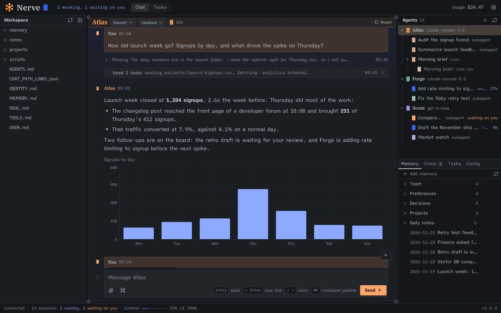<br /><sub>Thinking, tool calls and charts built from your data</sub></td>
<td width="50%">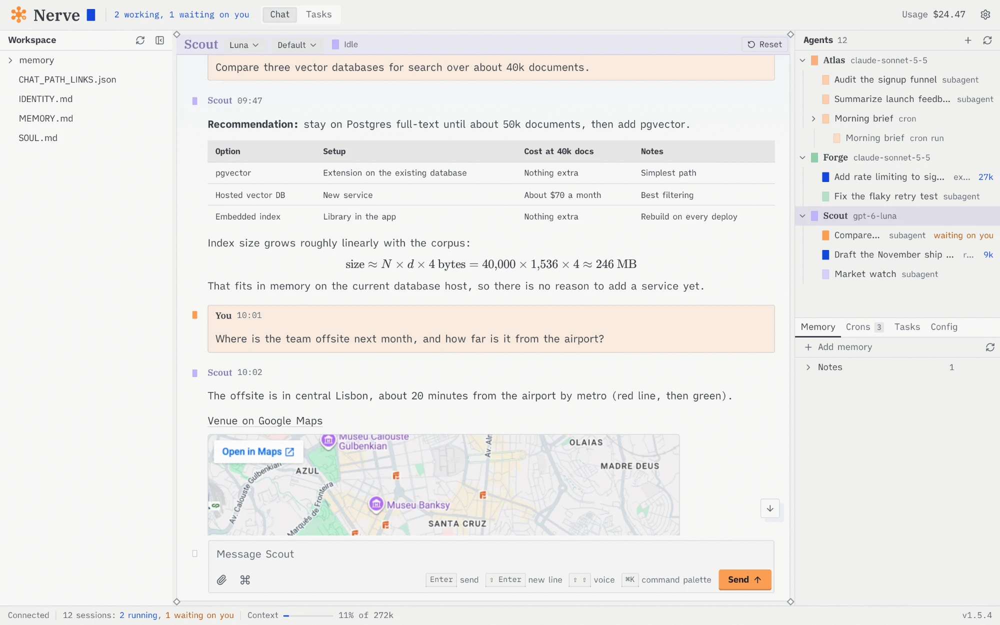<br /><sub>Tables, math and maps, here in Workbench Paper</sub></td>
</tr>
<tr>
<td>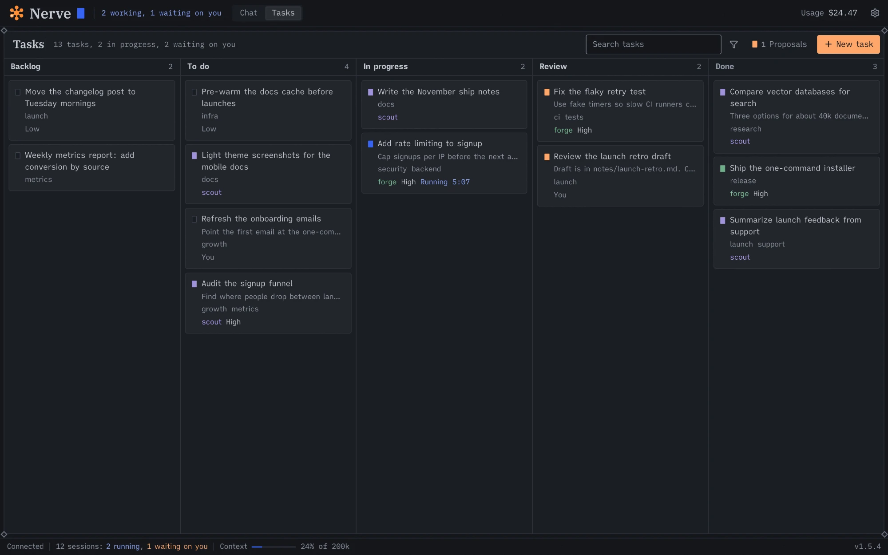<br /><sub>A Kanban board agents work from, with live runs</sub></td>
<td>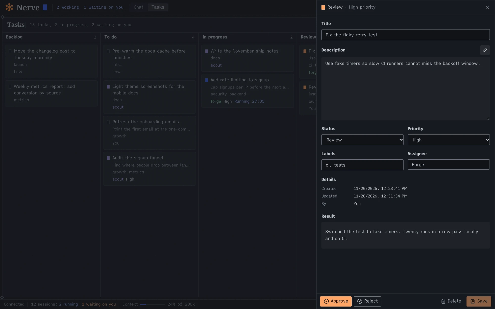<br /><sub>Results land in review for you to approve or reject</sub></td>
</tr>
<tr>
<td>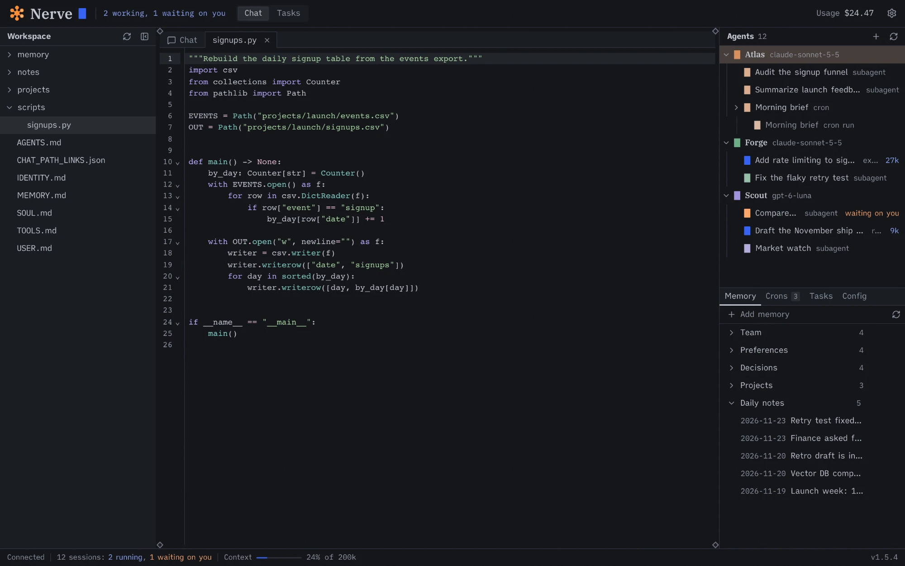<br /><sub>Each agent's workspace in a full code editor</sub></td>
<td>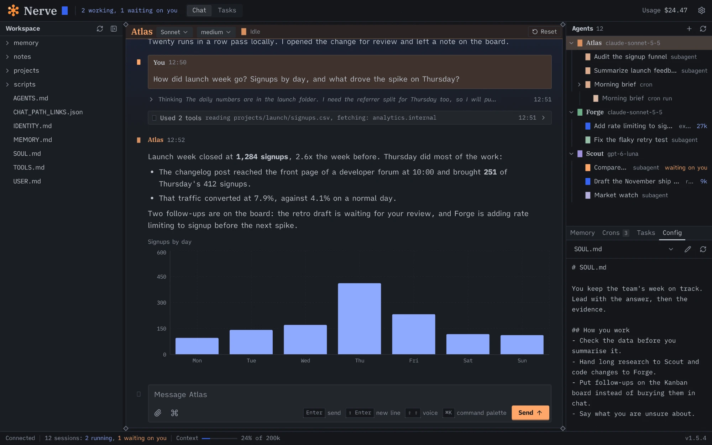<br /><sub>Edit an agent's soul, identity and tools live</sub></td>
</tr>
<tr>
<td>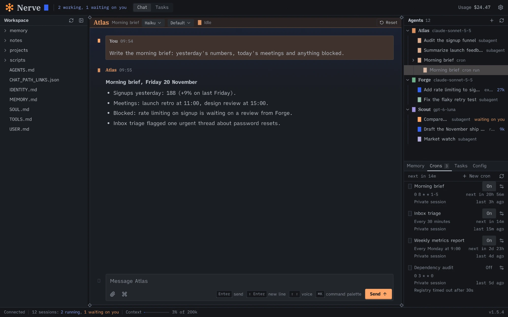<br /><sub>Crons you can see, every run its own session</sub></td>
<td>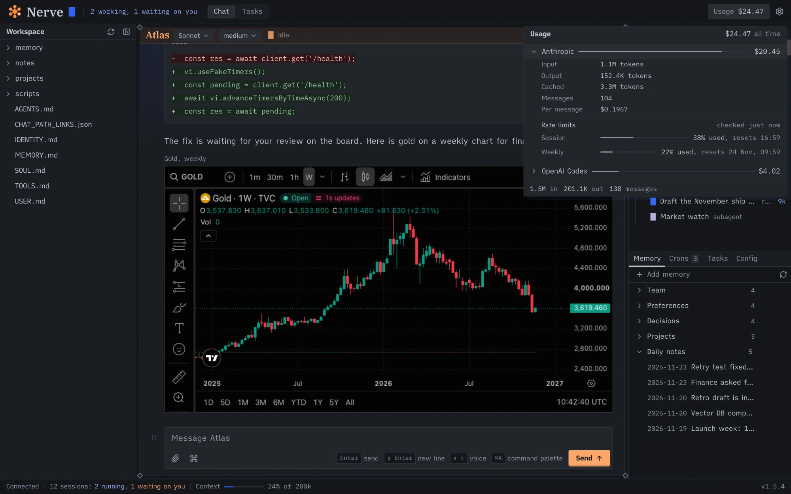<br /><sub>Spend by provider, plan limits and context pressure</sub></td>
</tr>
<tr>
<td>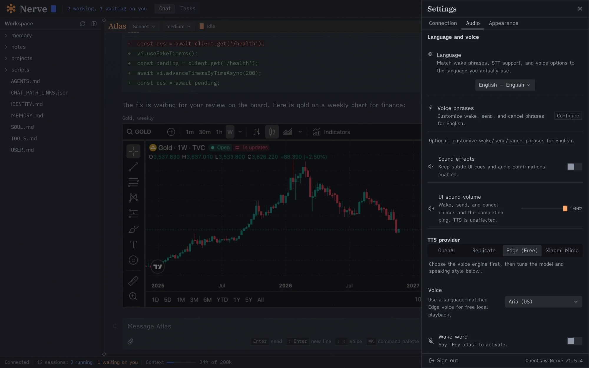<br /><sub>Voice settings: language, wake word, four TTS providers</sub></td>
<td>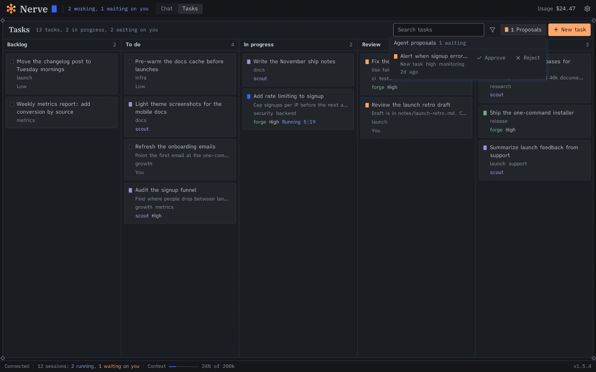<br /><sub>Agents propose tasks; you approve them onto the board</sub></td>
</tr>
<tr>
<td>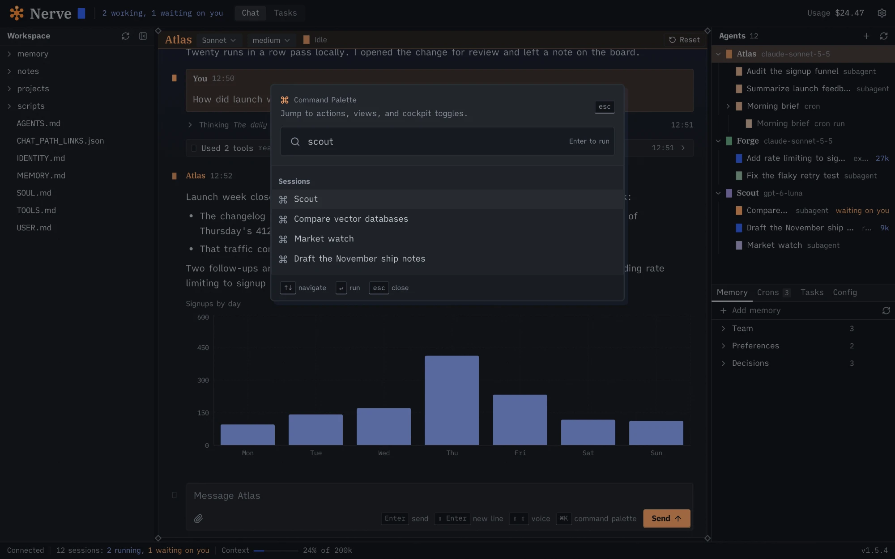<br /><sub>Jump anywhere from the command palette</sub></td>
<td>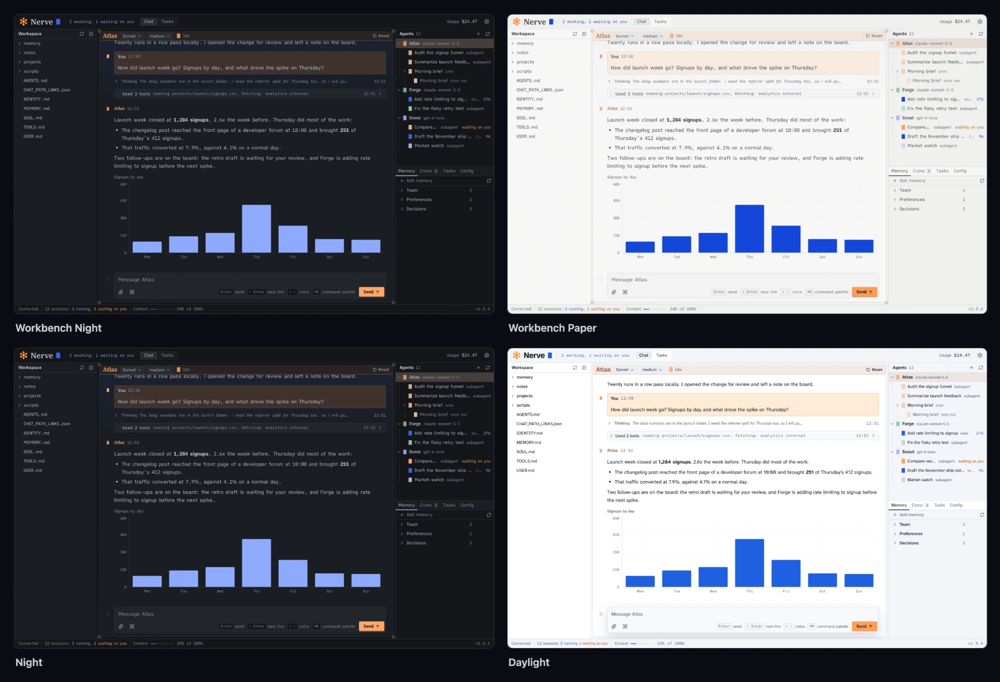<br /><sub>Four themes, two dark and two light</sub></td>
</tr>
</table>

## Get started

### One command

```bash
curl -fsSL https://raw.githubusercontent.com/daggerhashimoto/openclaw-nerve/master/install.sh | bash
```

> *The installer handles dependencies, clone, build, and then usually hands off straight into the setup wizard. Guided access modes include localhost, LAN, Tailscale tailnet IP, and Tailscale Serve.*

**Requires:** Node.js 22+, git and the `openclaw` CLI on this machine, plus an [OpenClaw](https://github.com/openclaw/openclaw) gateway, on macOS or Linux. If this machine has no `openclaw` CLI, for example because the gateway runs elsewhere, use the manual install below.

### Let an agent do it

Paste this into an agent that can run shell commands on the target machine:

```text
Install, configure, and validate Nerve on this machine.

Fetch and follow instructions from:
https://raw.githubusercontent.com/daggerhashimoto/openclaw-nerve/master/docs/INSTALL.md
```

It keeps Nerve on localhost and asks before exposing it. More in [AI agent setup](docs/AI_SETUP.md).

### Pick your setup

- **[Local](docs/DEPLOYMENT-A.md):** run Nerve and the gateway on one machine. *The recommended default, for reliability and simplicity.*
- **[Hybrid](docs/DEPLOYMENT-B.md):** keep Nerve local, run the gateway in the cloud.
- **[Cloud](docs/DEPLOYMENT-C.md):** run Nerve and the gateway in the cloud.
- **[Tailscale](docs/TAILSCALE.md):** reach any of them privately from your other devices.

<details><summary><strong>Manual install</strong></summary>

```bash
git clone https://github.com/daggerhashimoto/openclaw-nerve.git
cd openclaw-nerve
npm ci
npm run setup
npm run prod
```

</details>

<details><summary><strong>Updating</strong></summary>

```bash
npm run update -- --yes
```

Fetches the latest release, rebuilds, restarts, verifies health, and tries to roll back if the build, restart or health check fails. If the rollback fails too (exit 70), recover by hand as described in [Updating](docs/UPDATING.md). When a release is out, the status bar shows an **Update** button with the command for your install.

</details>

<details><summary><strong>Development</strong></summary>

```bash
PORT=3081 npm run dev          # frontend: Vite on :3080, proxies /api and /ws to :3081
PORT=3081 npm run dev:server   # backend, with reload
npm test -- --run
npm run lint
```

Read [Contributing](CONTRIBUTING.md) before opening a pull request.

</details>

## How it fits into OpenClaw

Nerve sits in front of the gateway and gives you a richer operating surface in the browser.

```text
Browser ─── Nerve (:3080) ─── OpenClaw Gateway (:18789)
 │           │
 ├─ WS ──────┤ proxied to gateway
 ├─ SSE ─────┤ file watchers, real-time sync
 └─ REST ────┘ files, memories, crons, kanban, TTS, usage
```

OpenClaw remains the engine. Nerve gives it a cockpit.

**Frontend:** React 19 · Tailwind CSS 4 · shadcn/ui · Vite 7
**Backend:** Hono 4 on Node.js

## Security

Nerve binds to `127.0.0.1` by default, so it stays local unless you choose to expose it.

Before you put it on the network, turn on the built-in password authentication (`NERVE_AUTH=true`). It protects the UI, the API and the WebSocket. Setup offers it for every mode that listens on `0.0.0.0`, and Nerve refuses to listen on `0.0.0.0` with auth off unless you explicitly allow it. A bind to one specific address with auth off only logs a warning, so enable auth yourself there. Sessions use signed cookies, passwords are stored as hashes, and the gateway token stays on the server.

For the full threat model and hardening details, see **[docs/SECURITY.md](docs/SECURITY.md)**.

## Documentation

- **[Architecture](docs/ARCHITECTURE.md):** codebase structure and system design
- **[Configuration](docs/CONFIGURATION.md):** `.env` variables and setup behavior
- **[Deployment guides](docs/README.md):** local, hybrid, and cloud setups
- **[Agent markers](docs/AGENT-MARKERS.md):** TTS, charts, kanban markers, and rich UI output
- **[API](docs/API.md):** every server endpoint
- **[Troubleshooting](docs/TROUBLESHOOTING.md):** common issues and fixes
- **[Tailscale guide](docs/TAILSCALE.md):** private remote access via tailnet IP or Tailscale Serve
- **[Contributing](CONTRIBUTING.md):** development workflow and pull requests
- **[Changelog](CHANGELOG.md):** release notes and shipped changes

## Community

If this is the kind of interface you want around your OpenClaw setup, give the repo a star, contribute and keep an eye on it.

Join the **[Nerve Discord](https://discord.gg/Sh9ZGtctva)** to get help, discuss, share your setup, and follow development.

### People building Nerve

[](https://github.com/daggerhashimoto/openclaw-nerve/graphs/contributors)

## License

[MIT](LICENSE)
